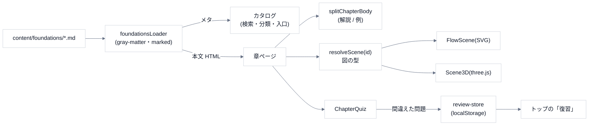

# 1. 全体像

## データの流れ

## ページ

| パス | 内容 |
|---|---|
| `/` | カタログ(まずはここから・用途から・すべて・検索・復習) |
| `/foundations/[id]` | 章: 目次・見出し・手順の図・解説 / 例 / クイズ・つながりの地図 |
| `/basics`・`/about`・`/updates` | 基礎・このサイトについて・更新履歴(手書きの静的データ) |

## データの置き場所

| もの | 場所 |
|---|---|
| 章 | `content/foundations/*.md`(Git に入る) |
| 更新履歴 | `src/lib/updates.ts`(手書き。新しいものを先頭に足す) |
| 復習の記録 | localStorage `fe-review-v1` |
| 好み | localStorage: `fe-scene-view`(平面 / 立体)・`fe-guess-first`(先に予想)・`fe-motion`(動きを減らす)・`fe-theme`(テーマ) |
| サーバー・DB | **無い**(Vercel の静的生成) |

## コマンド・環境

`npm run dev` / `build` / `start` / `lint`。**自動テストは無い**。Node は、Next.js 16 が動く版。依存は `next` 16・`react` 19・`gray-matter`・`marked`・`three`。

## やらないこと(範囲の外)

- **立体の図で、実際の寸法・数値を表すこと**(概念図)。
- **学ぶ順序の「前提」の断定**(章のつながりは、本文のリンクの事実だけ)。
- ユーザー登録・サーバー保存。
